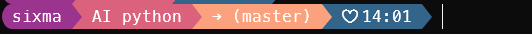

<div align="center">

# ⚡ S-li (Six Life Injoy)

**專為 Windows 與跨平台打造的現代化美學終端提示符 (Shell Line Interface)**

*讓每一天的終端機，都兼具極致美感、即時狀態感知與軍規級資安防護。*

[](LICENSE)
[](SECURITY.md)
[](#-四大終端支援與安裝指南)
[](#-自訂主題與外觀切換-sli-cli)

---

### 📷 效果展示 (Visual Preview)



</div>

### ✨ 核心架構解析 (Segment Breakdown)

`S-li` **不需要**您額外下指令查詢狀態，而是**直接原生覆蓋**您現有的各類 CLI 提示符（Prompt / PS1）。每一次按 Enter、切換目錄或變更分支，都會即時動態呈現：

```text
[ 🟣 使用者身份 ]  [ 🔴 工作目錄 / Python venv ]  [ 🟠 Git 分支與變更 ]  [ 🔵 符號與時間 ]  |
```

1. **使用者識別 (Identity)**：預設顯示當前 Windows / Linux 帳號（如 `sixma`），支援自訂代號，並提供一鍵「隱私模式」遮蔽。
2. **目錄與 Python 虛擬環境 (Path & Python Venv)**：
   - 自動即時偵測 `.venv`、`venv`、`conda`、`poetry`、`pipenv`、`uv` 等虛擬環境，以 `🐍 (環境名)` 優雅標示。
   - 智慧簡化家目錄長路徑為 `~`，保留清晰工作目錄名稱。
3. **Git 即時狀態 (Git Pulse)**：
   - 即時顯示當前分支 `→ (master)`。
   - 若程式碼有未提交的變更，自動加上醒目標記 `* → (master)` 並切換為警示色段落。
4. **個性符號與時間 (Time & Icons)**：
   - 顯示自訂愛心符號 `♡` 與當前時間（`HH:mm`），帶來溫暖愉悅的敲碼體驗。

---

## 🛠️ 前置準備 (Prerequisites)

為了讓 Powerline 膠囊箭頭（``）、愛心（`♡`）與分支符號（`→`）完美渲染而不破圖，請確保完成以下兩項準備：

### 1. 建議使用現代終端機：Windows Terminal
- Windows 11 已內建，Windows 10 可由 Microsoft Store 安裝或執行：
  ```powershell
  winget install Microsoft.WindowsTerminal
  ```

### 2. 安裝 Nerd Fonts 字型（必備）
推薦以下兩款官方字型（兩者皆內含完整 Powerline 符號）：
- **[JetBrains Mono Nerd Font](https://www.nerdfonts.com/font-downloads)** (極力推薦)
- **[Cascadia Code NF](https://github.com/microsoft/cascadia-code/releases)**

**安裝步驟**：
1. 下載字型壓縮檔解壓縮後，全選 `.ttf` 檔案，按滑鼠右鍵選擇 **「為所有使用者安裝」**。
2. 開啟 Windows Terminal ➜ 點選下拉選單進入 **「設定」 (Ctrl + ,)**。
3. 點選左側「預設值」➜「外觀」➜ 將 **字型** 改為 `JetBrainsMono Nerd Font` 或 `Cascadia Code NF`。

---

## 🚀 四大終端支援與安裝指南

只需克隆本專案至您的本地目錄（例如 `C:\Projects\S-li`）：

```powershell
git clone https://github.com/your-username/S-li.git
cd S-li
```

### 1. PowerShell (7+ 及 Windows PowerShell 5.1)
執行專案隨附的一鍵安裝腳本：
```powershell
Set-ExecutionPolicy -Scope Process -ExecutionPolicy Bypass
.\install.ps1
```
*或是手動安裝*：在您的 `$PROFILE` 檔案中加入以下這一行即可：
```powershell
. "C:\路徑\到\S-li\core\powershell\sli-prompt.ps1"
```

---

### 2. Git Bash (Windows MSYS2 / MinGW)
開啟 Git Bash，在 `~/.bashrc` 中加入引用：
```bash
echo '[ -f "/c/路徑/到/S-li/core/bash/sli-prompt.sh" ] && source "/c/路徑/到/S-li/core/bash/sli-prompt.sh"' >> ~/.bashrc
source ~/.bashrc
```

---

### 3. Linux WSL (Ubuntu / Debian / Arch)
在 WSL 終端執行：
```bash
./install.sh
# 重新載入設定
source ~/.bashrc
```

---

### 4. Windows CMD (命令提示字元)
CMD 由於歷史架構限制，建議搭配 Windows 終端必備神器 **Clink** 達到 100% 相同美感：
1. 安裝 Clink：
   ```powershell
   winget install chrisant996.Clink
   ```
2. 將本專案中的 `core\clink\sli.lua` 複製到 `%LocalAppData%\clink\` 目錄下：
   ```powershell
   copy .\core\clink\sli.lua "$env:LOCALAPPDATA\clink\"
   ```
3. 開啟 CMD，即可享受與 PowerShell 毫無二致的色彩與即時 Git 渲染！

---

## 🎨 自訂主題與外觀切換 (`sli` CLI)

在 `S-li` 中，日常敲指令由**原生覆蓋的提示符**全自動運作；而 `sli` 指令工具則是用來**輔助調整風格、切換色彩與隱私保護**。

```powershell
sli <指令> [選項]
```

### 常用功能列表

| 指令 | 說明 |
| :--- | :--- |
| `sli theme` | 列出當前主題庫與目前啟用主題 |
| `sli theme sunset` | 切換為經典落日粉紫漸層主題（預設，對齊截圖） |
| `sli theme cyberpunk` | 切換為賽博朋克霓虹主題 (Neon 2077) |
| `sli theme nord` | 切換為北歐極簡冰霜冷調 (Arctic Frost) |
| `sli style nerd_arrow` | 設定為 Powerline 尖角箭頭風格 (``) |
| `sli style nerd_rounded`| 設定為圓角膠囊風格 (``) |
| `sli style ascii` | 切換為免字型平替模式 (`>`)，不裝 Nerd Font 也不破圖 |
| `sli user <name>` | 自訂第一段顯示名稱（例如 `sli user sixma`） |
| `sli privacy on` | **開啟隱私模式**：遮蔽真實帳號與路徑（適合錄影、簡報、截圖） |
| `sli privacy off` | 關閉隱私模式，恢復正常顯示 |
| `sli preview` | 即時預覽當前樣式效果 |

---

## 🔒 資安防護標準 (Security-First Architecture)

本專案未來將推送到 GitHub 開源社群，因此嚴格落實安全開發規範：

1. **零未知二進位執行檔**：
   - 拒絕預編譯的 `.exe` / `.dll` 等黑箱檔案，所有邏輯皆為公開透明的原生腳本（PowerShell、Bash、Lua）。
2. **無任意代碼注入**：
   - 提示符運算全程杜絕 `Invoke-Expression` 與 `eval`，防止惡意指令注入風險。
3. **機敏資訊防護與 CI 掃描**：
   - 配置軍規級 `.gitignore`，徹底排除 `.env`、私密金鑰（`.pem`, `.key`, `id_rsa`）、認證權杖與系統暫存。
   - 內建 `.github/workflows/security-scan.yml`，每次提交皆由 **Gitleaks** 進行金鑰外洩防禦掃描。
4. **專屬安全性政策**：
   - 遵循標準開源通報機制，詳見 [`SECURITY.md`](SECURITY.md)。

---

## 💡 常見問題 (FAQ)

<details>
<summary><b>Q1: 為什麼終端機出現問號或方塊框框亂碼？</b></summary>
這代表您的終端機尚未使用支援 Powerline 的 Nerd Fonts 字型。請參考上面的 <a href="#2-安裝-nerd-fonts-字型必備">字型安裝說明</a> 下載安裝 <code>JetBrainsMono Nerd Font</code>，或使用 <code>sli style ascii</code> 切換成免特殊符號的相容模式。
</details>

<details>
<summary><b>Q2: 啟動 Python 虛擬環境時沒有顯示圖示？</b></summary>
當您在終端機啟動虛擬環境（例如 <code>.venv\Scripts\Activate.ps1</code> 或 <code>conda activate env_name</code>）時，S-li 會自動感知 <code>$env:VIRTUAL_ENV</code> 並顯示。若您使用的是自訂路徑，可透過 <code>sli preview</code> 檢視識別狀態。
</details>

<details>
<summary><b>Q3: 如何徹底解除安裝並還原？</b></summary>
只需開啟您的 <code>$PROFILE</code>（PowerShell）或 <code>~/.bashrc</code>（Git Bash/WSL），將包含 <code>sli-prompt</code> 的那一列刪除並儲存即可，完全不留多餘垃圾。
</details>

---

## 📄 授權條款 (License)

本專案採用 [MIT License](LICENSE) 條款開放原始碼，歡迎自由使用、個人客製或分享給團隊夥伴！
